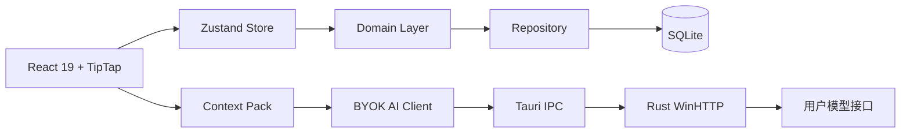
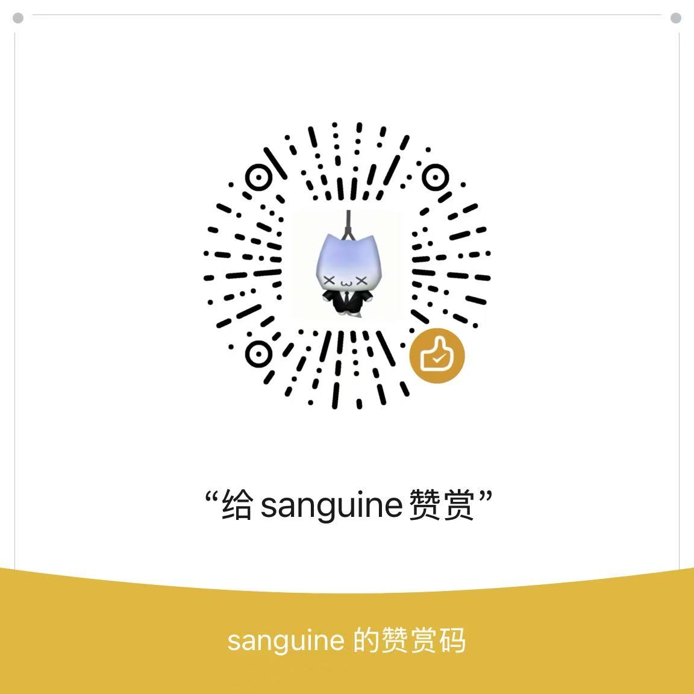

<p align="center">
  <strong>微光写作台 · Weiguang Writer</strong><br />
  <sub>Windows 本地优先写作工作台 × 可控 BYOK AI × 结构化写作状态</sub>
</p>

<p align="center">
  
  
  
  
  <br />
  
  
  
</p>

<p align="center">
  <a href="https://www.wemin.icu">官方网站</a> ·
  <a href="https://github.com/xixi-BEEP-xixi/weiguang-writer/releases">Releases</a> ·
  <a href="docs/开源发布文章.md">完整技术设计与实现</a> ·
  <a href="apps/desktop/src-tauri/legal/USER_TERMS.txt">用户条款</a>
</p>

## 微光写作台是什么

面向中文长篇小说和连载作者的 Windows 本地写作工作台。正文、故事圣经、时间线、伏笔、长期记忆、版本快照和分析报告保存在本机；AI 通过用户自己的 OpenAI 兼容 API 接入。

## 产品边界

- Windows 桌面端，Tauri 2 + React + TypeScript
- 正文、故事圣经、长期记忆、搜索索引和恢复点保存在本机
- 不提供账号、云同步、遥测、在线授权或自有业务服务器
- 不使用 Git 作为应用内版本系统
- 不内置任何本地 AI 模型
- AI 功能必须由用户配置自己的 OpenAI 兼容 API
- AI 请求直接发往用户选择的模型服务商，不经过本项目自有服务器

## 功能

- TipTap/ProseMirror JSON 正文`r`n- 正文排版：首行缩进、字体、字号、行距、段间距和段落对齐
- 项目、卷、章、场景与多书架切换
- 独立大纲：卷、章、场景的目标、冲突、转折、结果、人物和状态`r`n- 故事圣经、时间线、伏笔和人物关系
- 本地全文搜索，支持标题、人物别名和设定别名
- 场景恢复点、逐段 Diff 和版本恢复
- TXT、Markdown、DOCX 按章节导入
- TXT、Markdown、DOCX、EPUB 导出
- 完整项目备份，包含正文、设定、长期记忆、恢复点和分析报告
- AI 续写、改写、大纲、人物小传和故事问答`r`n- AI 大纲只生成候选，作者确认后才填入
- 改写结果先展示 Diff，确认后替换选区
- 结构化长期记忆：候选、已确认、已拒绝、原文证据
- 只有作者确认的记忆才会进入后续 AI 上下文
- 场景一致性检查、分块全书体检和拆书
- 自动模型参考价、月度 Token 上限和本机用量统计
- Windows DPAPI 加密保存 API Key
- 默认浅色界面、任意背景色和自定义背景图片

## 与通用 AI 写作的区别

| | 通用 AI 聊天 | 微光写作台 |
|---|---|---|
| 正文真源 | 对话文本 | TipTap / ProseMirror JSON |
| 数据位置 | 平台账号或浏览器 | 本机 SQLite |
| AI 接入 | 平台内置模型 | 用户自己的 API Key |
| 改写 | 直接覆盖 | Diff 预览，确认后写回 |
| 长期记忆 | 摘要或向量黑盒 | 候选 / 确认 / 拒绝 + 原文证据 |
| 全书分析 | 单次长上下文 | 本地分块压缩 + 最终报告 |
| 网络依赖 | 必须在线 | 写作、搜索、导入导出可离线 |

## 技术架构



- 表现层：React 19、TipTap / ProseMirror、Lucide
- 领域层：文档遍历、导入导出、Diff、报告 AST、搜索
- 数据层：SQLite、场景快照、长期记忆、AI 操作记录
- 原生层：Rust、WinHTTP、Windows DPAPI、数据库备份
- 浏览器回退：`sql.js + IndexedDB`，仅用于开发环境

详细架构、数据表、AI 数据流、分析流水线、失败处理和构建验证见：[完整技术设计与实现](docs/开源发布文章.md)。

## 隐私

- 项目数据目录：`%APPDATA%\com.weiguang.writer`
- 数据库、恢复点和分析报告只保存在本机
- API Key 不写入项目数据库、日志或备份
- 使用 AI 时，必要上下文会发送到用户配置的模型接口
- 软件不包含遥测、分析脚本和自动上传
- 第三方组件说明见 `apps/desktop/THIRD-PARTY-NOTICES.md`

## 开发环境

需要：

- Windows 10/11
- Node.js 20 或更高版本
- Rust stable 与 MSVC Build Tools
- WebView2 Runtime

安装依赖：

```powershell
cd apps/desktop
npm ci
```

开发模式：

```powershell
npm run tauri:dev
```

仅启动前端：

```powershell
npm run dev
```

## 测试

```powershell
cd apps/desktop
node node_modules/typescript/bin/tsc --noEmit
node node_modules/vitest/vitest.mjs run
cargo test --manifest-path src-tauri/Cargo.toml
```

## 用户条款

安装向导会展示并请求确认用户使用条款。软件内“设置 → 用户条款与隐私”使用同一份源文件：

`apps/desktop/src-tauri/legal/USER_TERMS.txt`

## 构建 Windows 版本

```powershell
cd apps/desktop
npm run tauri:build
```

安装包输出位于：

```text
apps/desktop/src-tauri/target/release/bundle/nsis/
```

## Windows 代码签名

正式分发需要受 Windows 信任的代码签名证书。仓库提供签名脚本：

```powershell
cd apps/desktop
$env:WINDOWS_CODESIGN_THUMBPRINT = '<证书 SHA1 指纹>'
powershell -ExecutionPolicy Bypass -File scripts/sign-windows.ps1 <exe-path>
```

也可以使用 PFX：

```powershell
$env:WINDOWS_CODESIGN_PFX = 'C:\path\to\certificate.pfx'
$env:WINDOWS_CODESIGN_PASSWORD = '<pfx-password>'
powershell -ExecutionPolicy Bypass -File scripts/sign-windows.ps1 <exe-path>
```

签名后会使用 `signtool verify /pa` 自动验证。没有受信任证书时只能生成未签名安装包。

无安装程序打包：

```powershell
$env:CARGO_NET_OFFLINE='true'
node node_modules/@tauri-apps/cli/tauri.js build --no-bundle
```

输出：

```text
apps/desktop/src-tauri/target/release/weiguang-writer.exe
```

## 项目结构

```text
apps/desktop/
  src/                  React 前端、数据层和领域逻辑
  src-tauri/            Tauri/Rust 原生层、SQLite、DPAPI、WinHTTP
  public/               静态资源
  THIRD-PARTY-NOTICES.md
docs/                   补充设计说明
```

## AI 接入

支持 OpenAI 兼容的 `/chat/completions` 接口。项目不包含模型，也不提供 API Key。

应用会：

- 根据模型名称自动匹配内置参考价
- 对未知模型只记录实际 Token，不虚构价格
- 在请求前提供上下文摘要、Token 估算和上限检查
- 仅在用户主动操作时调用模型 API

模型价格可能随服务商调整，最终以服务商账单为准。

## 数据恢复

- 每日自动数据库备份保留最近 14 份
- 场景恢复点默认每个场景保留最近 40 份
- 完整项目 JSON 备份可迁移到另一台机器
- 旧版安装目录数据会在启动时自动迁移，并在需要时先备份空目标库

## 已知限制

- 当前只支持 Windows
- AI 功能依赖网络和用户自己的 API Key
- 全书分析速度取决于模型服务、限流和上下文长度
- 大型项目的搜索和长期记忆仍需继续做性能验证
- 正式公开分发前建议完成 Windows 代码签名

## 参与贡献

请阅读 [CONTRIBUTING.md](CONTRIBUTING.md)。安全问题请按 [SECURITY.md](SECURITY.md) 私下报告，不要公开提交包含利用细节的 Issue。

## 官方网站与自愿赞赏

- 官方网站：<https://www.wemin.icu>
- 如果微光写作台对你的写作有帮助，可以自愿赞赏支持后续开发。
- 赞赏属于自愿支持，不购买软件功能、商业授权、定制开发或技术服务；软件源代码仍按 MIT License 授权。

<p align="center">
  
</p>

## 许可证

本项目使用 [MIT License](LICENSE)。

第三方组件、字体和图标遵循各自许可证。