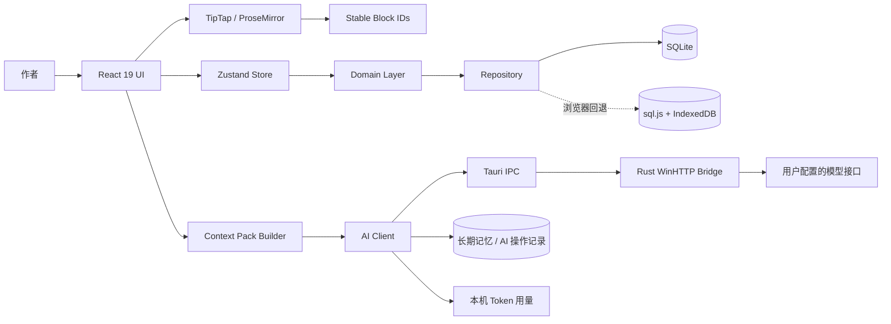
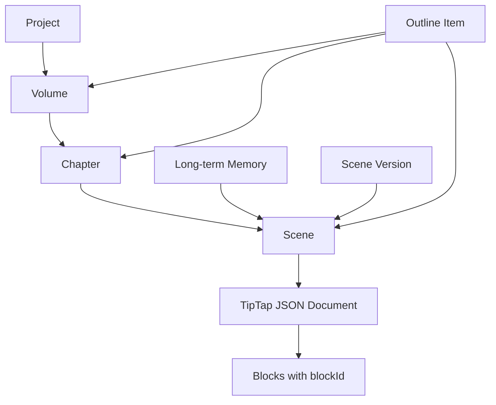
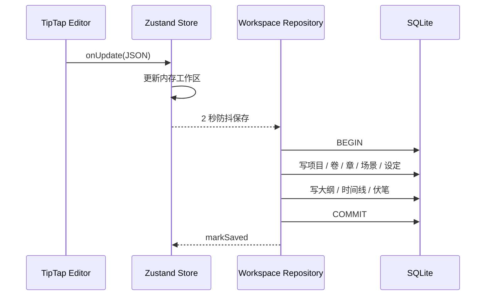
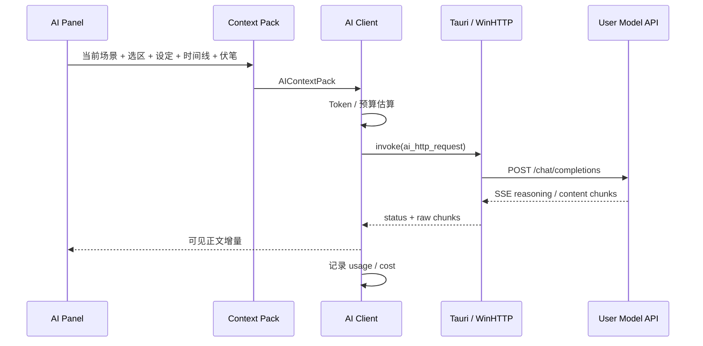
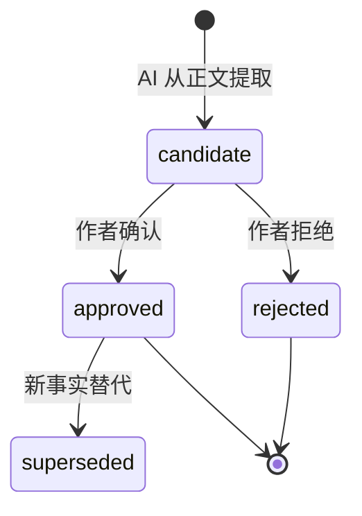
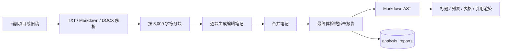
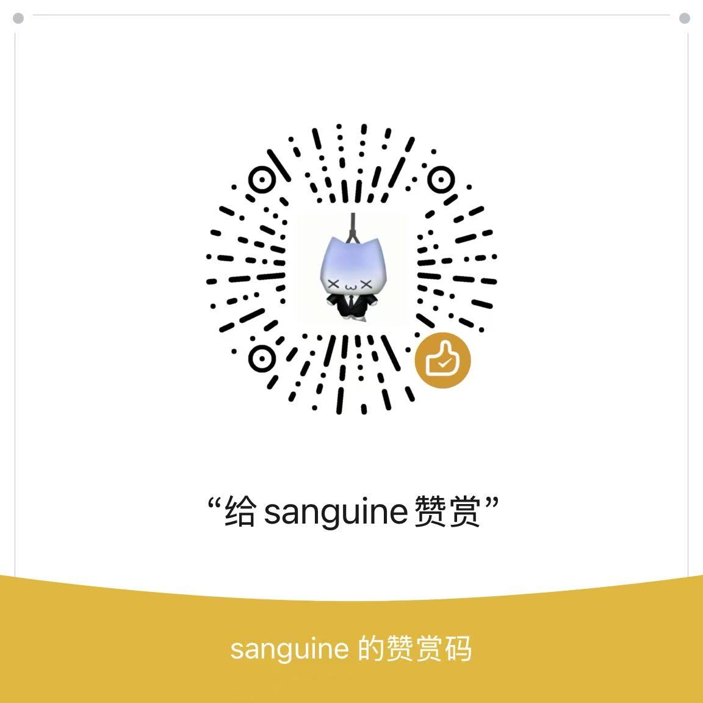

<p align="center">
  <strong>微光写作台 · Weiguang Writer</strong><br />
  <sub>Windows 本地优先写作工作台 × 可控 BYOK AI × 结构化写作状态</sub>
</p>

<p align="center">
  
  
  
  
  <br />
  
  
  
  
</p>

<p align="center">
  <a href="https://www.wemin.icu">官方网站</a> ·
  <a href="https://github.com/xixi-BEEP-xixi/weiguang-writer">GitHub</a> ·
  <a href="https://github.com/xixi-BEEP-xixi/weiguang-writer/releases">Releases</a> ·
  <a href="../README.md">README</a>
</p>

---

# 微光写作台 0.2：本地优先小说写作系统的工程实现

通用 AI 能写出一段文字，却很少能维护一部长篇小说真正的状态：人物关系、时间线、伏笔、章节目标、历史版本，以及“这次 AI 输出到底有没有进入正文”。

微光写作台不是把聊天框塞进编辑器，也不是一个自动生成整本小说的 Agent。它把长篇写作拆成可持久化、可审计、可恢复的工程对象，并让 AI 只在你主动发起的范围内工作。

本文说明 0.2 版本的技术设计、数据流、失败边界和取舍。

---

## 1. 与通用 AI 写作的区别

|  | 通用 AI 聊天 | 微光写作台 0.2 |
|---|---|---|
| 正文真源 | 对话内容，难以稳定回写 | TipTap / ProseMirror JSON，按场景持久化 |
| 数据位置 | 服务商账号或浏览器缓存 | 本机 SQLite + 本机备份 |
| AI 接入 | 平台内置模型 | 用户自己的 OpenAI 兼容 API，BYOK |
| 上下文 | 依赖聊天窗口和手工粘贴 | `AIContextPack` 结构化组装 |
| 改写 | 直接覆盖文本 | Diff 预览，作者确认后替换选区 |
| 长期记忆 | 对话摘要或向量记忆黑盒 | 候选 → 已确认 → 已拒绝，保留原文证据 |
| 全书分析 | 一次请求塞入整本书 | 本地分块压缩 + 最终报告 |
| 版本历史 | 页面级撤销或无 | 场景快照 + 内容哈希 + 逐段 Diff |
| 数据上传 | 默认经过平台服务器 | 只发送到你配置的模型接口 |
| 网络依赖 | 必须在线 | 写作、搜索、导入导出和分析报告均可离线使用 |

---

## 2. 系统总览



系统分为四层：

| 层 | 职责 | 主要文件 |
|---|---|---|
| 表现层 | 编辑器、书架、大纲、设定、分析报告 | `apps/desktop/src/components` |
| 领域层 | 文档遍历、导入导出、Diff、报告解析与搜索 | `apps/desktop/src/domain` |
| 数据访问层 | SQLite、版本、报告、AI 记忆、回退存储 | `apps/desktop/src/data` |
| 原生层 | WinHTTP、DPAPI、窗口图标、数据库备份 | `apps/desktop/src-tauri/src` |

---

## 3. 正文模型：Scene 是原子单位

数据结构不是“一本书一个巨大 Markdown 文件”，而是：



核心约束：

- `Project → Volume → Chapter → Scene` 使用稳定 ID。
- Chapter 是容器，Scene 才是正文原子单位。
- 每个可定位正文块都有稳定 `blockId`。
- 选区、评论、记忆证据和 AI 改写都依赖 `blockId`，而不是易变的字符位置。
- 正文以 ProseMirror JSON 保存，Markdown/HTML 只作为导入导出表示。

正文 JSON 示例：

```json
{
  "type": "doc",
  "content": [
    {
      "type": "paragraph",
      "attrs": { "blockId": "01M7..." },
      "content": [{ "type": "text", "text": "正文段落" }]
    }
  ]
}
```

---

## 4. 本地数据模型

SQLite 表按职责划分：

| 表 | 作用 |
|---|---|
| `projects` / `volumes` / `chapters` / `scenes` | 作品结构 |
| `characters` | 人物卡 |
| `bible_cards` | 地点、物品、组织、设定 |
| `timeline_events` | 故事时间线 |
| `foreshadows` | 伏笔与回收状态 |
| `outline_items` | 卷/章/场景大纲 |
| `memory_items` | 候选、已确认、已拒绝长期记忆 |
| `ai_operations` | AI 生成、插入、报告操作历史 |
| `scene_versions` | 场景快照 |
| `analysis_reports` | 全书体检与拆书报告 |
| `settings` | 界面和活动项目状态 |
| `schema_migrations` | 数据版本记录 |

`memory_items` 的关键字段：

```sql
evidence_block_id TEXT NULL,
evidence TEXT NOT NULL,
status TEXT NOT NULL,
memory_key TEXT NOT NULL
```

这意味着记忆不是一段不可追溯的摘要，而是能回到正文块、查看原文证据、被确认或拒绝的数据对象。

---

## 5. 保存与恢复链路



实现细节：

- 编辑更新先进入 Zustand，界面无需等待磁盘。
- 工作区保存采用 2 秒防抖，减少高频写入。
- 原生仓库在一个事务中重写工作区表，失败时回滚并给出具体阶段错误。
- 浏览器开发环境保留 `sql.js + IndexedDB` 回退。
- SQLite 写锁冲突设置 `busy_timeout`、有限重试和报告保存降级，避免已经生成的分析结果因短暂锁冲突丢失。

数据目录：

```text
%APPDATA%\com.weiguang.writer\
  changye-writer.db
  backups\
  ai-credentials.bin
  diagnostics.log
```

---

## 6. 版本历史与 Diff

场景恢复点不是 Git 仓库，而是 SQLite 快照：

1. 每 5 分钟对正文超过 20 字的活动场景创建自动快照。
2. 手动保存可添加自定义版本标签。
3. 快照保存完整 ProseMirror JSON、纯文本预览、字数、内容哈希和时间。
4. 相同内容和标签通过哈希去重。
5. 每个场景默认保留最近 40 个版本。
6. 恢复前先保存当前正文，再应用目标版本。
7. 版本比较将正文拆成段落，通过 LCS 动态规划生成 `same / added / removed` 行。

版本恢复同样是“先快照、后覆盖”，避免恢复动作本身造成不可逆丢失。

---

## 7. AI 接入：BYOK，不提供模型

微光写作台不包含本地模型，也不代理模型请求。

- Base URL、模型、API Key、温度、输出上限由用户配置。
- 请求只允许发往用户填写的 OpenAI 兼容 `/chat/completions` 接口。
- Windows 下由 Rust WinHTTP 桥发送请求，读取 SSE 数据块并通过 Tauri Channel 回传。
- 浏览器开发模式下使用 Fetch，便于调试。
- API Key 使用 Windows DPAPI 加密保存，不进入 SQLite、日志或安装包。

请求链路：



### 思考模式不等于正文字数

DeepSeek Flash / V4 的思考 Token 与可见正文共用 completion budget。

系统处理方式：

- 普通创作调用可配置 `thinking: disabled | low | high`。
- `reasoning_content` 不会进入正文，也不会进入正文字数统计。
- 思考 Token 单独记录在 usage 中。
- 若模型只返回推理、没有可见正文，系统自动重试一次关闭思考的请求。
- 用户取消后，原生请求通过原子取消标记终止，不产生新的 usage 记录。

### 流式解析

AI Client 同时支持两类响应：

- OpenAI 兼容 SSE：逐块解析 `data:`，只把 `content` 追加到正文。
- 非流式 JSON：一次性解析 `choices[0].message.content`。

错误层会清理 HTML、二进制乱码和服务商堆栈，转换成稳定的中文错误信息。

---

## 8. Context Pack：控制上下文，而不是“全塞进去”

AI 请求由结构化上下文包组装：

```ts
interface AIContextPack {
  scene_snapshot: { doc_json: JSONContent; content_hash: string };
  selection: { block_start_id: string; block_end_id: string; text: string } | null;
  nearby_text: string;
  story_cards: StoryCard[];
  foreshadows: Foreshadow[];
  timeline_events: TimelineEvent[];
  token_budget: { input: number; output: number };
}
```

当前预算策略：

- 当前场景正文最多截取后 12,000 字符。
- 当前选区最多 12,000 字符。
- 上一场景结尾最多 1,800 字符。
- 下一场景开头最多 900 字符。
- 故事设定最多 30 条。
- 时间线最多 24 条。
- 伏笔最多 60 条。
- 请求前计算输入估算、最大输出、月 Token 上限和可选金额预算。

这比直接拼接全书更稳定，也能让作者知道本次请求大致会发送什么。

---

## 9. 长期记忆：候选、确认、拒绝

长期记忆不是自动写入的聊天摘要，而是一个可审计状态机：



提取流程：

1. 从当前场景正文提取明确事实。
2. 禁止推测心理、计划和未发生事件。
3. 返回 JSON：类型、标题、事实、置信度、原文证据。
4. 通过 `memory_key` 去重。
5. 根据证据短句定位 `blockId`。
6. 候选记忆不会进入上下文。
7. 只有 `approved` 记忆参与后续请求。
8. AI 操作历史记录单独保存在 `ai_operations`，并区分 generated / inserted / dismissed / report。

这是“结构化记忆”，不是“无限上下文”。

---

## 10. 全书体检与拆书流水线

长篇文本不会一次性塞进模型。



工程约束：

- 分块优先按换行边界切分，避免从句子中间截断。
- 每个分块压缩人物、事件、时间、地点、冲突、伏笔、钩子和文风信息。
- 最终报告使用单独提示词和 16,000 Token 输出预算。
- 上传旧稿必须勾选版权或授权确认。
- 报告只读取文本，不修改正文。
- 取消通过 `AbortController` 传递到 AI 请求。
- 报告落库失败时保留本地回退副本，且向用户暴露真实错误。

报告不是直接显示 Markdown 原文，而是解析成结构化块：

```ts
type AnalysisReportBlock =
  | { type: 'heading'; level: 1 | 2 | 3 | 4; text: string }
  | { type: 'paragraph'; text: string }
  | { type: 'list'; ordered: boolean; items: string[] }
  | { type: 'quote'; lines: string[] }
  | { type: 'table'; headers: string[]; rows: string[][] };
```

`#`、`---`、表格分隔行等控制字符不会泄漏到阅读界面。

---

## 11. 导入导出

| 格式 | 导入 | 导出 | 实现 |
|---|---:|---:|---|
| TXT | 是 | 是 | 本地章节识别 + 纯文本 |
| Markdown | 是 | 是 | 章节标题与段落解析 |
| DOCX | 是 | 是 | Mammoth 导入，docx 库导出 |
| EPUB | 否 | 是 | JSZip 打包 XHTML |
| JSON 项目备份 | 是 | 是 | 完整工作区快照 |

DOCX 导入由 Mammoth 转成 HTML，再映射为标题、段落和列表；导入到项目时同步生成章、场景和大纲记录，避免出现“有正文但没有章节结构”的孤儿数据。

---

## 12. Windows 与安全边界

- 生产网络桥：Rust + WinHTTP，支持 HTTPS、SSE、超时、取消和 64 MB 响应上限。
- 凭据：Windows DPAPI，只允许当前 Windows 用户解密。
- CSP：默认只加载本地资源；连接仅允许 Tauri IPC 和本地开发端口。
- 无账号系统、无遥测、无云同步、无自有业务服务器。
- 第三方组件许可证随安装包提供。
- 安装向导展示用户条款；软件内“用户条款与隐私”与安装器共用同一份源文件。
- 安装包提供 SHA256；正式分发应使用受信任的 Windows 代码签名证书。

---

## 13. 性能与失败处理

| 场景 | 策略 |
|---|---|
| 高频编辑 | Zustand 内存更新 + 2 秒防抖持久化 |
| 大文本 | 8,000 字符分块压缩 |
| 长 AI 输出 | 目标长度与思考预算分开，输出结果二次裁剪 |
| 模型只返回思考 | 自动回退到关闭思考模式重试一次 |
| SQLite 锁冲突 | `busy_timeout` + 指数退避 + 报告本地降级 |
| 用户取消 | 请求 ID 级原子取消，禁止后台结果覆盖新请求 |
| 版本占用 | 每场景最多保留 40 个版本 |
| 报告占用 | 每种报告最多保留最近 10 份 |

---

## 14. 构建与测试

### 开发

```powershell
git clone https://github.com/xixi-BEEP-xixi/weiguang-writer
cd weiguang-writer/apps/desktop
npm ci
npm run tauri:dev
```

### 前端检查

```powershell
node node_modules/typescript/bin/tsc --noEmit
node node_modules/vitest/vitest.mjs run
```

### Rust

```powershell
cargo test --manifest-path src-tauri/Cargo.toml
```

当前状态：

- 22 个 Vitest 测试文件
- 43 个前端测试
- 4 个 Rust 测试
- Windows NSIS 安装包构建成功
- 安装包尚未完成受信任代码签名

---

## 15. 项目结构

```text
apps/desktop/
  src/
    components/          React UI
    data/                AI、SQLite、版本、记忆、备份
    domain/              文档、导入导出、Diff、报告 AST
    assets/              本地字体与静态资源
  src-tauri/
    src/lib.rs           WinHTTP、DPAPI、图标、数据库备份
    installer/           NSIS 品牌图与安装钩子
    legal/               用户使用条款
  scripts/
    sign-windows.ps1     Authenticode 签名脚本
docs/
  开源发布文章.md
```

---

## 16. 设计取舍与已知限制

### 为什么不用 Git 作为应用内版本系统

应用内版本只作用于场景正文，不需要提交整个仓库。SQLite 快照更轻，能直接关联项目、场景和版本标签；Git 可以作为外部工作流，但不是运行时依赖。

### 为什么没有做本地向量搜索

0.2 的搜索是本地加权关键词检索，优先保证离线、体积和可解释性。语义搜索需要本地 embedding 模型、向量索引和额外维护成本，暂不纳入当前版本。

### 为什么 AI 不是 Agent

当前版本没有自主工具循环。AI 调用由作者明确发起，输出需要作者确认，记忆需要作者确认。这是有意的权限边界，不是“全自动写作”。

### 当前限制

- 仅 Windows 桌面端。
- 安装包未签名。
- 没有账号、云同步和实时协作。
- AI 输出仍需人工核对。
- Token 和价格统计依赖用户配置的模型接口返回值。
- 全书体检和拆书的耗时、费用取决于文本长度和模型。

---

## 17. 官方网站与自愿赞赏

- 官方网站：<https://www.wemin.icu>
- 项目与 Releases：<https://github.com/xixi-BEEP-xixi/weiguang-writer>
- 赞赏属于自愿支持，不购买软件功能、商业授权、定制开发或技术服务。

<p align="center">
  
</p>

## 18. License

MIT License.

Copyright (c) 2026 Weiguang Writer contributors.

软件源代码依据 MIT License 授权；官方安装包使用随附用户条款。用户导入的稿件、AI 生成内容和第三方模型服务由用户自行确认权利、费用与合规边界。

---

<p align="center"><strong>灯可以亮，但方向盘应该在作者手里。</strong></p>